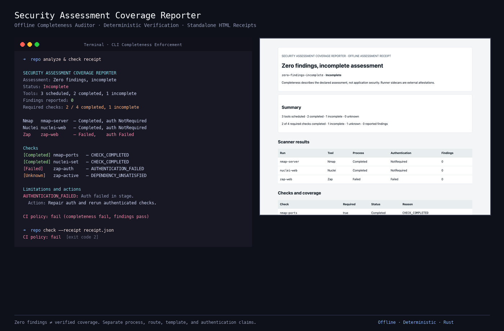
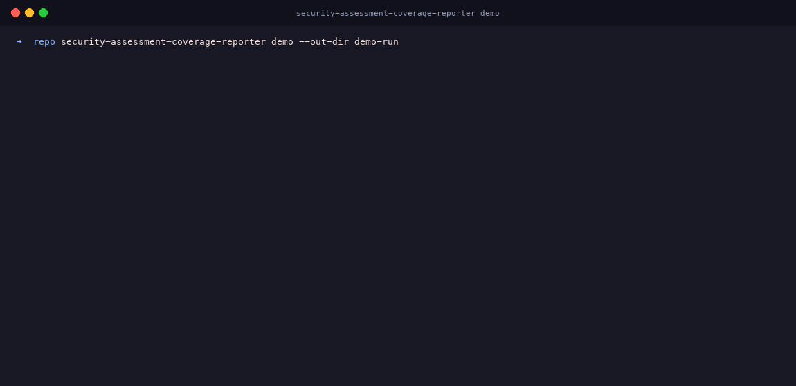
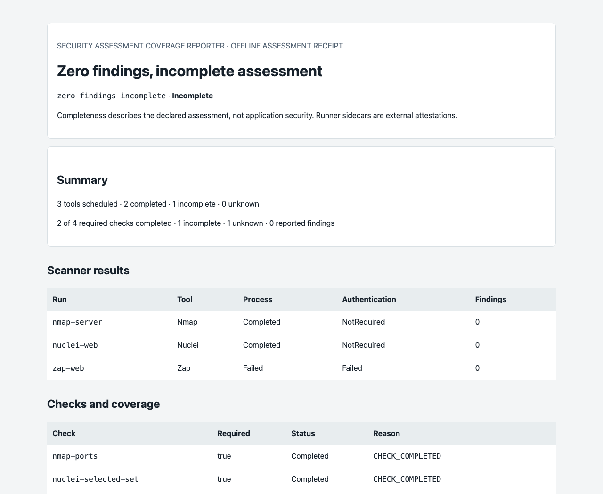
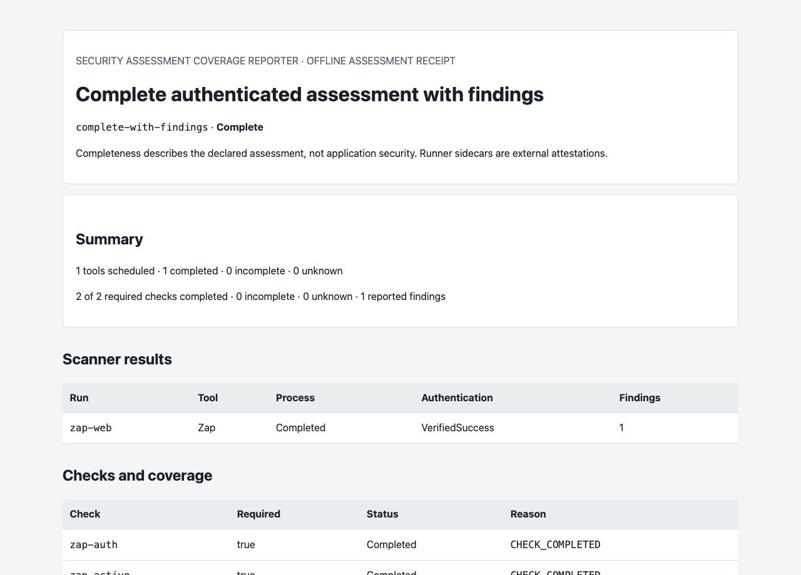
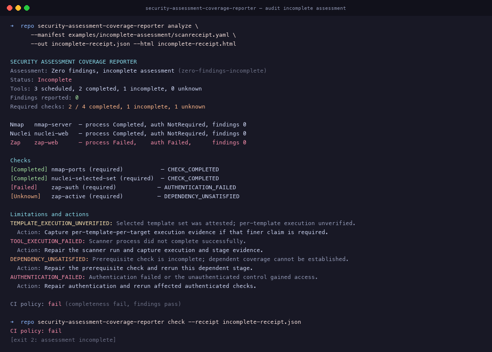
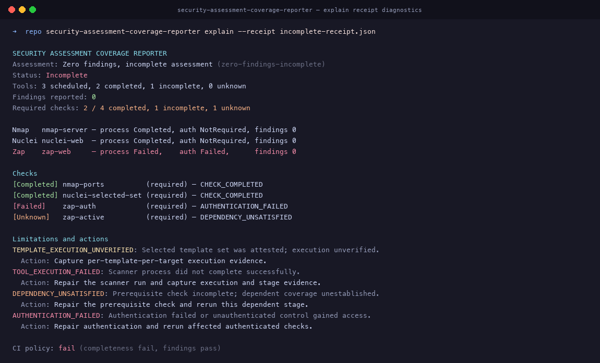

# Security Assessment Coverage Reporter

**Know what your security scans actually tested.**

[](https://github.com/ranajahanzaib/security-assessment-coverage-reporter/actions/workflows/ci.yml)
[](LICENSE)
[](Cargo.toml)

A security pipeline can report zero vulnerabilities while authentication silently failed, a target was missed, or an active scanner exited prematurely. **Security Assessment Coverage Reporter** is an offline audit engine that reads raw Nmap, OWASP ZAP, and Nuclei artifacts alongside declared assessment contracts. It evaluates whether your scans actually performed what was declared, verifies coverage dimensions, and generates deterministic canonical JSON receipts and standalone HTML reports.



---

## The Problem

Most automated security testing pipelines suffer from a silent completeness failure:

```text
[Pipeline] Scanners finished: 0 findings reported. Build PASSED!
```

Behind the scenes:

- **Authentication failed**: ZAP scanned login forms without an authenticated session, missing all protected endpoints.
- **Host unreachable**: Nmap reported zero open ports because the target was down, yet the step succeeded.
- **Empty findings mistaken for coverage**: Nuclei ran zero templates or was terminated before executing target sets.

**Security Assessment Coverage Reporter separates process execution, coverage criteria, and vulnerability findings.** Zero findings is never treated as proof of execution.

---

## Key Features

- **Offline & Zero Network Dependencies**: Analyzes checked-in or pipeline-generated scanner artifacts without scanner installations, Docker daemon, or live network probing.
- **Multi-Scanner Support**:
  - **Nmap XML (`1.03`–`1.05`)**: Parses TCP scaninfo, host addresses, user hostnames, host status, explicit TCP port states (`open`, `closed`, `filtered`), and `runstats/finished` exits.
  - **OWASP ZAP (Traditional JSON / JSON Plus / Auth Report)**: Audits alert counts, Automation Framework plan errors, and authentication summary states (`auth.summary.auth`).
  - **Nuclei (JSONL Findings / Statistics)**: Extracts verified finding targets; parses external runner stage attestations for declared template and target sets.
- **Independent Verification & Sidecars**: Distinguishes tool self-reports from independent positive authentication controls (`schemas/verification.schema.json`) and external runner stage attestations (`schemas/execution.schema.json`).
- **Deterministic Receipts**: Outputs canonical JSON (`schemas/receipt.schema.json`) with sorted keys, allowlisted facts, SHA-256 artifact digests, and reproducible IDs without volatile timestamps.
- **Standalone HTML Receipt**: Produces a zero-dependency, self-contained HTML report with embedded CSS, accessible tables, limitation cards, and collapsible evidence logs.
- **Actionable Remediation**: Emits stable reason codes (e.g. `AUTHENTICATION_FAILED`, `DEPENDENCY_UNSATISFIED`, `EXPECTED_PORTS_MISSING`) with human-readable explanations and remediation instructions.
- **Separated Policy Enforcement**: Assessment completeness policy (`fail` / `ignore`) is decoupled from findings policy, enabling separate gatekeeping in CI/CD.

---

## Terminal Demonstration



---

## Quick Start

Requires **Rust 1.88** or newer.

### Installation

```sh
git clone https://github.com/ranajahanzaib/security-assessment-coverage-reporter.git
cd security-assessment-coverage-reporter
cargo build --release
cargo install --path . --locked  # installs `security-assessment-coverage-reporter` to ~/.cargo/bin
```

### Try the Bundled Offline Demo

The reporter includes a complete offline demonstration scheduling Nmap, Nuclei, and ZAP where ZAP authentication fails:

```sh
# Copy sample artifacts and run offline evaluation
cargo run -- demo --out-dir demo-run

# Enforce the CI completeness policy (exits 2 due to incomplete auth)
cargo run -- check --receipt demo-run/assessment-receipt.json
```

```text
SECURITY ASSESSMENT COVERAGE REPORTER
Assessment: Zero findings, incomplete assessment (zero-findings-incomplete)
Status: Incomplete
Tools: 3 scheduled, 2 completed, 1 incomplete, 0 unknown
Findings reported: 0
Required checks: 2 / 4 completed, 1 incomplete, 1 unknown

Nmap nmap-server — process Completed, auth NotRequired, findings 0
Nuclei nuclei-web — process Completed, auth NotRequired, findings 0
Zap zap-web — process Failed, auth Failed, findings 0

Checks
[Completed] nmap-ports (required) — CHECK_COMPLETED
[Completed] nuclei-selected-set (required) — CHECK_COMPLETED
[Failed] zap-auth (required) — AUTHENTICATION_FAILED
[Unknown] zap-active (required) — DEPENDENCY_UNSATISFIED

Limitations and actions
AUTHENTICATION_FAILED: Authentication failed or the unauthenticated control gained access. Action: Repair authentication and rerun affected authenticated checks.
DEPENDENCY_UNSATISFIED: A prerequisite check is incomplete or unknown, so dependent coverage cannot be established. Action: Repair the prerequisite check and rerun this dependent stage.

CI policy: fail (completeness fail, findings pass)
```

---

## Visual Showcase

### Standalone HTML Assessment Receipts

The reporter generates standalone HTML dashboards with embedded styles, requiring no external web servers or internet access:

|                         Incomplete Assessment Receipt                         |                      Complete Authenticated Receipt                       |
| :---------------------------------------------------------------------------: | :-----------------------------------------------------------------------: |
|             |  |
| _Zero findings reported, but authentication failed & active scan was skipped_ |   _Complete declared assessment with verified auth probe and 1 finding_   |

### CLI Workflows

|                     Policy Failure & Audit Breakdown                     |                    Receipt Diagnostics (`explain`)                    |
| :----------------------------------------------------------------------: | :-------------------------------------------------------------------: |
|        |                       |
| _`analyze` and `check` failing CI on incomplete authentication (exit 2)_ | _`explain` providing stable reason codes and actionable remediations_ |

---

## Commands

| Command                                               | Purpose                                                                         |
| :---------------------------------------------------- | :------------------------------------------------------------------------------ |
| `init [--out PATH]`                                   | Scaffold a starter manifest (`scanreceipt.yaml`) and `evidence/` directory.     |
| `validate --manifest PATH [--check-files]`            | Validate syntax, scope identifiers, criteria compatibility, and file existence. |
| `analyze --manifest PATH --out PATH [--html PATH]`    | Ingest artifacts, evaluate checks, and emit canonical JSON and standalone HTML. |
| `explain --receipt PATH`                              | Display terminal diagnostic breakdown, limitations, and remediation steps.      |
| `check --receipt PATH`                                | Enforce recorded completeness and findings policy decisions for CI/CD gates.    |
| `schema <manifest\|receipt\|execution\|verification>` | Print draft 2020-12 JSON Schema definitions for manifests or receipts.          |
| `demo [--out-dir PATH]`                               | Unpack sample fixtures and execute an offline assessment demonstration.         |

### Global Flags & Exit Codes

- `--quiet`: Suppress non-essential informational terminal output (ideal for scripting and CI gates).
- `--no-color`: Disable ANSI color formatting (output is clean plain text).
- `--help`, `-h`: Print help documentation.
- `--version`, `-V`: Print CLI version.

#### Exit Codes

- `0`: Success (or CI policy passed).
- `2`: CI policy failed (e.g. required check incomplete or findings threshold exceeded).
- `3`: Input error, schema mismatch, or I/O failure.

---

## Assessment Contract (`scanreceipt.yaml`)

An assessment manifest defines the declared security expectations:

```yaml
schema_version: 1
assessment:
  id: network-and-web-ci
  name: Staging Environment Assessment

scope:
  - id: app-host
    kind: host
    value: staging.internal.test
  - id: app-url
    kind: url
    value: https://staging.internal.test/app

runs:
  - id: nmap-network
    tool: nmap
    scope_ids: [app-host]
    artifacts:
      - kind: report
        path: evidence/nmap.xml

  - id: zap-web
    tool: zap
    scope_ids: [app-url]
    artifacts:
      - kind: report
        path: evidence/zap.json
      - kind: authentication
        path: evidence/zap-auth.json
      - kind: execution
        path: evidence/zap-execution.json

checks:
  - id: tcp-ports
    run_id: nmap-network
    kind: tcp_port_scan
    criteria:
      ports: "22,80,443,8080"

  - id: zap-login
    run_id: zap-web
    kind: authentication

  - id: zap-active
    run_id: zap-web
    kind: active_scan
    depends_on: [zap-login]

policy:
  on_incomplete: fail
  on_inconclusive: fail
  on_findings: ignore
```

---

## Supported Evidence & Formats

| Tool          | Supported Artifacts                                                      | Extraction & Completeness Rules                                                                                                                                                                                                                                            |
| :------------ | :----------------------------------------------------------------------- | :------------------------------------------------------------------------------------------------------------------------------------------------------------------------------------------------------------------------------------------------------------------------- |
| **Nmap**      | `report` (`.xml`)                                                        | Parses `nmaprun` (versions `1.03`–`1.05`), TCP `scaninfo`, IPv4/IPv6 addresses, explicit host states, explicit port states (`open`, `closed`, `filtered`), and `finished/@exit`. Down hosts do not satisfy port checks; `extraports` is never allocated to specific ports. |
| **OWASP ZAP** | `report` (`.json`), `authentication` (`.json`), `plan` (`.yaml`/`.json`) | Reads alert counts, `afPlanErrors`, and authentication report `auth.summary.auth`. Automation Framework plans represent intent, not execution. Passwords, cookies, and tokens are discarded.                                                                               |
| **Nuclei**    | `findings` (`.jsonl`), `statistics` (`.jsonl`), `execution` (`.json`)    | Counts reported findings; verifies target scope. Template execution requires external runner stage attestations declaring selected template and target sets.                                                                                                               |

---

## CI/CD Integration

Integrate verification into GitHub Actions or any CI system without installing scanners:

```yaml
- name: Analyze Security Assessment Coverage
  run: |
    security-assessment-coverage-reporter analyze \
      --manifest scanreceipt.yaml \
      --out assessment-receipt.json \
      --html assessment-receipt.html

- name: Archive Assessment Receipts
  uses: actions/upload-artifact@v4
  if: always()
  with:
    name: assessment-receipts
    path: |
      assessment-receipt.json
      assessment-receipt.html

- name: Enforce Completeness Policy
  run: security-assessment-coverage-reporter check --receipt assessment-receipt.json
```

See [CI Integration Guide](docs/ci-integration.md) and [.github/workflows/ci.yml](.github/workflows/ci.yml) for full examples.

---

## Safety and Privacy

- **No Network Invocations**: The reporter operates purely on local files.
- **Strict Size Bounds**: Input files are limited to 16 MiB by default (configurable up to 128 MiB via `--max-artifact-bytes`).
- **Secret Sanitization**: Raw HTTP traffic, POST bodies, cookies, credentials, and authentication diagnostics are excluded from receipts.
- **Deterministic Hashes**: All ingested artifacts are fingerprinted with SHA-256 for audit provenance.
- **HTML Sanitization**: All user-declared strings and assessment metadata are HTML-escaped before rendering.

---

## Development & Testing

```sh
# Check code formatting
cargo fmt --check

# Run linter
cargo clippy --all-targets -- -D warnings

# Execute test suite (38 unit, integration, and property tests)
cargo test --locked

# Build release binary
cargo build --release --locked
```

### Documentation Links

- [Evidence Model & Provenance](docs/evidence-model.md)
- [Scanner Support Specifications](docs/scanner-support.md)
- [Stable Reason Codes & Remediations](docs/reason-codes.md)
- [Receipt Schema Contract](docs/receipt-schema.md)
- [Assessment Manifest Format](docs/manifest.md)
- [Limitations & Non-Goals](docs/limitations.md)

---


## License & Custom Work

[](mailto:work@withrana.com) [](https://www.linkedin.com/in/workwithrana)
[](https://www.upwork.com/freelancers/~01bbcf6edb91a8df5f)
[](https://contra.com/ranajahanzaib/)

**License:** MIT, see [LICENSE](LICENSE). Free for personal and commercial use.

**Author:** Rana Jahanzaib

**Need this built for your stack?** Email me what you're working on: work@withrana.com
